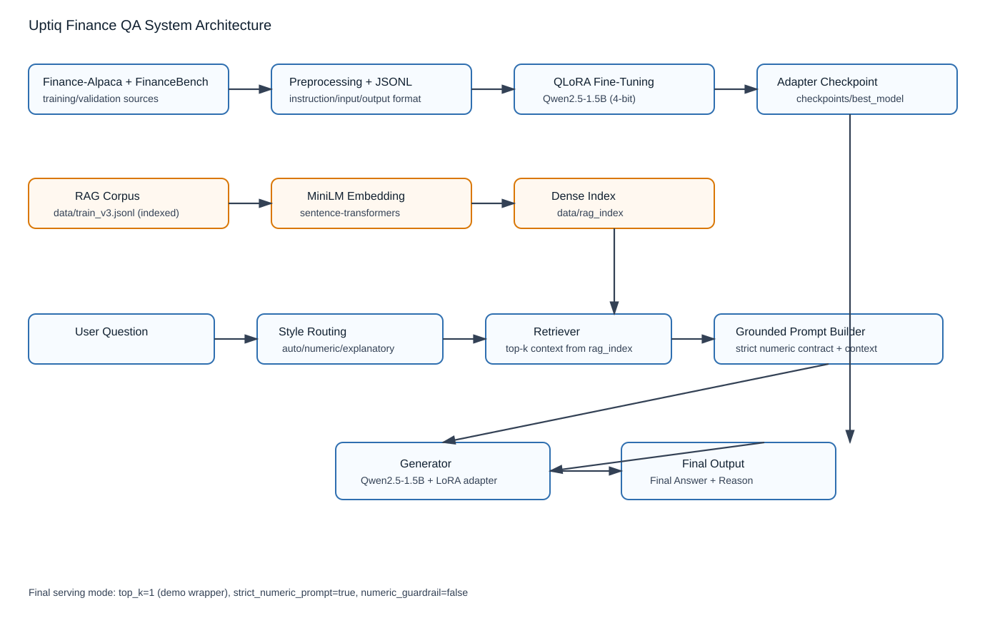

# FinRAG Intelligence

**An LLM-powered Financial Question Answering System using Retrieval-Augmented Generation (RAG)**

FinRAG Intelligence is a financial question-answering system designed to combine semantic retrieval and Large Language Models (LLMs) to generate context-grounded responses to financial questions.

The project explores parameter-efficient fine-tuning, dense vector retrieval, and evidence-based answer generation, with a focus on improving financial factuality and numerical reliability.

## Live Demo

**[Launch FinRAG Intelligence](https://finrag-intelligence-j7zntwukvbk9vjay7oqde9.streamlit.app/)**

**GitHub Repository:** [FinRAG-Intelligence](https://github.com/jaiswalswarnima/FinRAG-Intelligence)

FinRAG Intelligence is a finance-focused RAG application that answers financial concept questions using a curated knowledge base, semantic retrieval, and Groq-hosted LLM inference.

## Core Technologies

- Python and PyTorch
- Hugging Face Transformers
- Qwen2.5-1.5B-Instruct
- QLoRA and PEFT
- Sentence Transformers and dense vector retrieval
- NumPy and evaluation utilities

## Current System Capabilities

- Financial question answering using retrieved context
- Semantic similarity-based document retrieval
- Context-grounded LLM inference
- Configurable response styles and numeric-focused prompting
- Automated evaluation workflows

## Planned Enhancements

- Source-document citations and evidence traceability
- Hybrid retrieval and reranking
- Financial calculations with deterministic verification
- Financial report comparison and structured insights
- Interactive application for financial document analysis

Planned features will be documented as implemented only after development and testing.

## Evaluation and Reproducibility

The repository contains previously reported benchmark results from the existing reference implementation. These results are historical baseline measurements and have not yet been independently reproduced for the FinRAG Intelligence version.

New experiments and improvements will be evaluated separately and documented with their test configuration and results.

## Acknowledgements

This project builds upon the open-source implementation by Abhij248. Reused code, pretrained models, datasets, and other third-party components will retain appropriate attribution and will be used in accordance with their applicable licenses.

Base model reference: [Qwen2.5-1.5B-Instruct](https://huggingface.co/Qwen/Qwen2.5-1.5B-Instruct)

## 1) Problem Statement
Fine-tune a small open-source language model for finance-domain Q&A and demonstrate measurable improvement over a base model.

---

## 2) Model Selection
- **Base Model:** `Qwen/Qwen2.5-1.5B-Instruct`
- **Why this model:**
  - Lightweight enough for consumer GPU constraints (RTX 3050, 4GB VRAM)
  - Strong instruction-following baseline
  - Good performance/compute trade-off for assessment scope
- **Trade-offs:**
  - Lower reasoning depth than larger models
  - Needs fine-tuning + retrieval grounding for strong financial factuality

---

## 3) Final Approach
- Fine-tuning: **QLoRA adapters**
- Retrieval: **RAG-lite** over local dense index
- Final serving config (official):
  - `model=checkpoints/best_model`
  - `style_mode=auto`
  - `top_k=2`
  - `strict_numeric_prompt=true`
  - `numeric_guardrail=false`

---

## 3A) Architecture Diagram


---

## 4) Dataset
- Sources:
  - `gbharti/finance-alpaca`
  - `PatronusAI/financebench`
- Working sizes:
  - Train: ~3000 to ~4000 (iteration dependent)
  - Validation: ~300 to ~400
  - Benchmark test: 150 (`data/test.jsonl`)
- Format:
  - `instruction`, `input`, `output`
  - Structured answer style used in later runs:
    - `Final Answer: ...`
    - `Reason: ...`

---

## 5) Training Pipeline
- Tokenization: HF tokenizer (Qwen)
- Fine-tuning: QLoRA + 4-bit quantization
- Typical range across runs:
  - LR: `5e-5` to `2e-4`
  - Steps: ~60 to ~220
  - Batch size: 1 with gradient accumulation
  - Max sequence length: up to 448

---

## 6) Official Submission Snapshot (2026-04-09)
**Source of truth:** `evaluation/submission_manifest_2026-04-09.json`

### Metrics (FinanceBench-150)

| System                  | ROUGE-L | BLEU | Semantic Similarity | Numeric Accuracy | Hallucination Proxy |
|---|---:|---:|---:|---:|---:|
| Base | 0.0857 | 0.0170 | 0.4206 | 0.1508 (19/126) | 0.4200 |
| Fine-tuned | 0.1102 | 0.0436 | 0.4509 | 0.0873 (11/126) | 0.2467 |
| RAG Baseline Recheck | 0.3844 | 0.1921 | 0.5594 | 0.5556 (70/126) | 0.3000 |
| **RAG Strict-Numeric-Prompt (Final)** | 0.4093 | 0.2113 | 0.5852 | 0.5794 (73/126) | 0.2800 |

### Human Eval (Fixed Re-Rubric, 150)
- Baseline RAG: `65/150 (43.33%)` correct
- **Strict-Numeric-Prompt RAG (Final): `73/150 (48.67%)` correct**
- Delta: `+5.34` points

---

## 7) Key Observations
- Fine-tuning improved semantic quality over base but numeric accuracy remained weak.
- RAG produced major gains in grounded factual/numeric performance.
- A targeted **strict numeric prompt** improved final RAG metrics further.

### 7A) Isolated Impact of Fine-Tuning (No RAG)

| System (No RAG) | ROUGE-L | BLEU | Semantic Similarity | Numeric Accuracy | Hallucination Proxy |
|---|---:|---:|---:|---:|---:|
| Base       | 0.0857 | 0.0170 | 0.4206 | 0.1508 (19/126) | 0.4200 |
| Fine-tuned | 0.1102 | 0.0436 | 0.4509 | 0.0873 (11/126) | 0.2467 |

Takeaway:
- Fine-tuning improved semantic coherence and instruction alignment.
- Fine-tuning alone did not reliably solve numeric correctness.
- Retrieval augmentation was needed to close the numeric/factual gap.
- The numeric drop after fine-tuning indicates improved linguistic alignment without reliable numeric grounding, reinforcing the need for retrieval.

### 7B) Why This Works
- Fine-tuning improved response structure and domain-aligned phrasing.
- Retrieval added grounded financial evidence at inference time.
- Strict numeric prompt shaping reduced free-form generation drift on numeric questions.

Core system insight:
- Financial Q&A is retrieval-dominant for factual reliability; parametric memory alone is insufficient.

### 7C) Experiment Decision Log

| Variant | Result | Decision |
|---|---|---|
| `strict_numeric_prompt=true`, `numeric_guardrail=false` | Best automated metrics + best fixed-rubric human eval (`48.67%`) | **Selected as final** |
| `strict_numeric_prompt=false`, `numeric_guardrail=true` | Strong regression (semantic and hallucination proxy worsened) | Rejected |
| `strict_numeric_prompt=true`, `numeric_guardrail=true` | Regression vs strict-only and baseline | Rejected |

---

## 8) Repository Structure
```text
repo/
├── src/
├── configs/
├── data/
├── checkpoints/
├── evaluation/
├── scripts/
├── README.md
├── ARCHITECTURE.md
├── PROJECT_REPORT.md
└── requirements.txt
```

---

## 9) Setup
```powershell
pip install -r requirements.txt
```

---

## 10) Data Preparation
```powershell
python src/prepare_finance_datasets.py --train-size 3000 --val-size 300
```

---

## 11) Training (QLoRA Baseline)
```powershell
python src/train_qlora.py --config configs/train_v2.yaml
```

---

## 12) Build RAG Index
```powershell
python src/build_rag_index.py `
  --corpus data/train_v3.jsonl `
  --out-dir data/rag_index
```


## 13) Evaluation Commands (Official)
### A) Base vs Fine-tuned (FinanceBench-150)
```powershell
python src/evaluate_models.py `
  --base-model Qwen/Qwen2.5-1.5B-Instruct `
  --finetuned-model checkpoints/finance-qa-qlora-v4-numeric `
  --test-path data/test.jsonl `
  --out evaluation/results_v4_full.json `
  --predictions-out evaluation/predictions_v4_full.jsonl `
  --max-samples 150 `
  --max-new-tokens 96

python src/evaluate_financial_quality.py `
  --predictions evaluation/predictions_v4_full.jsonl `
  --out evaluation/financial_quality_v4_full.json `
  --sim-threshold 0.30 `
  --numeric-tolerance 0.05
```

### B) RAG Baseline Recheck (FinanceBench-150)
```powershell
python src/evaluate_rag.py `
  --model checkpoints/best_model `
  --index-dir data/rag_index `
  --test-path data/test.jsonl `
  --out evaluation/results_rag_full_baseline_recheck.json `
  --predictions-out evaluation/predictions_rag_full_baseline_recheck.jsonl `
  --max-samples 150 `
  --max-new-tokens 32 `
  --top-k 2 `
  --batch-size 1 `
  --style-mode auto
```

### C) RAG Final (Strict-Numeric-Prompt)
```powershell
python src/evaluate_rag.py `
  --model checkpoints/best_model `
  --index-dir data/rag_index `
  --test-path data/test.jsonl `
  --out evaluation/results_rag_full_strict_only.json `
  --predictions-out evaluation/predictions_rag_full_strict_only.jsonl `
  --max-samples 150 `
  --max-new-tokens 32 `
  --top-k 2 `
  --batch-size 1 `
  --style-mode auto `
  --strict-numeric-prompt
```

---

## 14) Submission Artifacts
- Final checkpoint: `checkpoints/best_model`
- Submission manifest: `evaluation/submission_manifest_2026-04-09.json`
- Hugging Face model artifacts (adapter): `https://huggingface.co/geek52/uptiq-finance-qa-qlora-rag`
- Hugging Face RAG index dataset: `https://huggingface.co/datasets/geek52/uptiq-finance-qa-rag-index`
- Base model reference (not re-uploaded): `Qwen/Qwen2.5-1.5B-Instruct`
- Automated result files:
  - `evaluation/results_rag_full_baseline_recheck.json`
  - `evaluation/results_rag_full_strict_only.json`
  - `evaluation/final_results_base_finetuned_150.json`
  - `evaluation/final_quality_base_finetuned_150.json`
- Human eval files:
  - `evaluation/human_eval_summary_rag_full_baseline_rerubric.json`
  - `evaluation/human_eval_summary_rag_full_strict_only_rerubric.json`
- Report and architecture:
  - `PROJECT_REPORT.md`
  - `ARCHITECTURE.md`

### 14A) Hugging Face Upload Contents (Explicit)
Fine-tuned model (QLoRA adapter) uploaded to:
- `https://huggingface.co/geek52/uptiq-finance-qa-qlora-rag`
- Files:
  - `adapter_model.safetensors`
  - `adapter_config.json`
  - `tokenizer.json`
  - `tokenizer_config.json`
  - `chat_template.jinja`
  - `training_meta.json`
  - `BEST_MODEL_MANIFEST.json`
  - `README.md` (model card)

RAG index uploaded to:
- `https://huggingface.co/datasets/geek52/uptiq-finance-qa-rag-index`
- Files:
  - `rag_index/docs.jsonl`
  - `rag_index/embeddings.npy`
  - `rag_index/meta.json`

Important clarification:
- Fine-tuned + RAG is represented by two hosted artifacts:
  - the fine-tuned adapter model repo (above), and
  - the RAG index dataset repo (above).
- The base model weights are not re-uploaded; they are referenced from `Qwen/Qwen2.5-1.5B-Instruct`.

---

## 15) Failure Taxonomy
Bucketed diagnostics on difficult human-labeled incorrect examples show four recurring patterns:

| Failure Type | Typical Symptom | Root Cause |
|---|---|---|
| Format error | No parseable numeric answer despite numeric question | Output format drift from expected `Final Answer` contract |
| Wrong number or unit | Value close but wrong scale/unit (e.g., million vs billion) | Weak unit grounding and conversion consistency |
| Reasoning mismatch | Retrieved relevant context but conclusion still wrong | Model inference error over grounded facts |
| Retrieval miss | Top retrieved chunks do not contain decisive evidence | Embedding similarity / chunk coverage limitation |

Observed pattern:
- Most residual errors are numeric-format and numeric-unit related, not pure retrieval failure.

---

## 16) Reproducibility Notes
- Tested on RTX 3050 (4GB VRAM)
- For low memory:
  - lower `max-new-tokens`
  - keep `batch-size=1`
- Known benign warning:
  - `embeddings.position_ids | UNEXPECTED`

---

## 17) Limitations and Future Work
Current limitations:
- Accuracy is improved but still below ideal production reliability for financial QA.
- Residual errors are concentrated in numeric formatting, unit handling, and harder multi-step reasoning.
- Answer quality remains sensitive to retrieval quality and chunk relevance.
- Small-model capacity (1.5B) can limit robustness on complex prompts.

Future work:
- Add preference alignment (DPO/RLHF) to improve factual faithfulness and completeness.
- Upgrade retrieval to hybrid dense+sparse with reranking for stronger evidence selection.
- Add tool-assisted arithmetic/checking for multi-step numeric questions.
- Improve inference performance with optimized serving and caching strategies.

---
